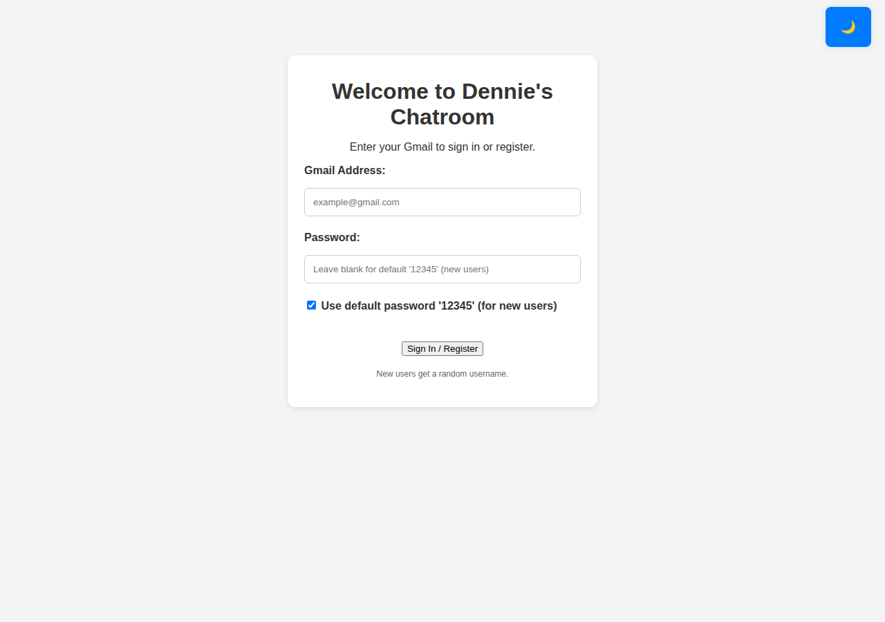
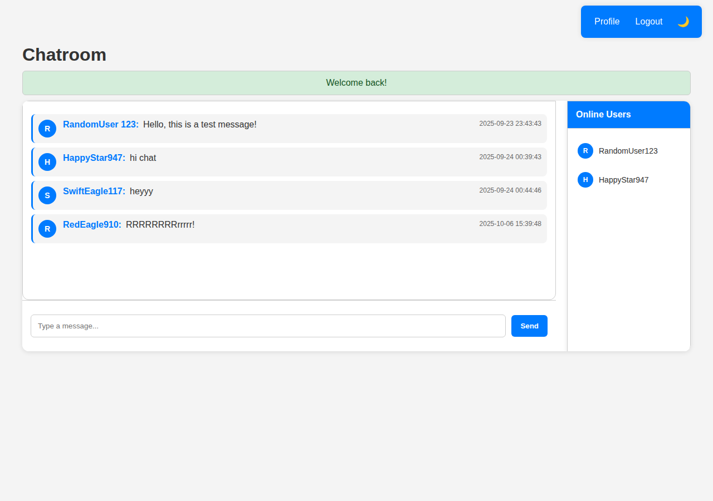
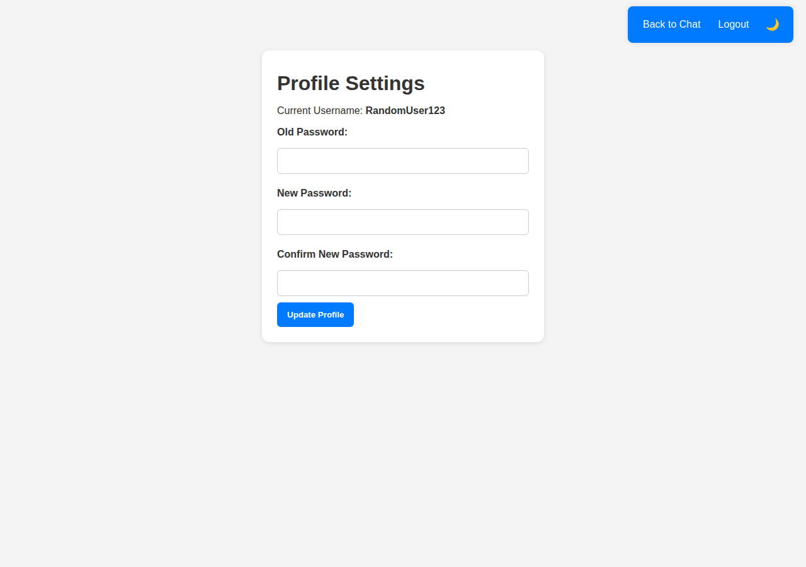

# Simple Chatroom

A small browser chatroom built for an Internet Technology course assessment. The sign-in page calls it Dennie's Chatroom. There is one shared room: anyone with an account can read and post messages there.

## Features

- Sign in with an email address. If the email is new, an account is created.
- New accounts get a random username made from an adjective, a noun, and a number (for example `SwiftEagle117`).
- Leaving the password blank on registration stores a bcrypt hash of `12345` and sets `is_default_password` to 1. Signing in always checks the password with `password_verify`, including that default. While the flag is still set, the account is sent to the profile page to change the password before the chat opens.
- The server ignores the "use default password" checkbox. An empty password field on registration is what selects the default-password path.
- While an account still has the default-password flag, its username can be changed once from the profile page. Changing the password clears the flag and locks the username.
- Messages are loaded by polling `get_messages.php` every 3 seconds (latest 50 messages, room 1 only). Sending a message posts to `send_message.php` (500 character limit).
- The sidebar lists users whose `last_active` timestamp is within the last 5 minutes. That list refreshes every 5 seconds.
- Light and dark theme, stored in the browser with `localStorage`.
- Logout destroys the PHP session.

Chat is a single shared room. `room_id` is stored on each message, and every query uses room `1`. Updates arrive by HTTP polling rather than a WebSocket.

## Tech stack

- PHP (sessions and PDO). No framework and no Composer packages. The original dump was exported with PHP 8.0.30.
- MariaDB (the dump was taken from MariaDB 10.4.32 with phpMyAdmin). Tables are InnoDB with `utf8mb4`. MySQL works if it accepts the same SQL.
- HTML, one stylesheet (`chat.css`), and vanilla JavaScript using `fetch`.
- Aimed at XAMPP: Apache serves the PHP files, and `config.php` defaults to MariaDB user `root` with an empty password on `localhost`.

## Local setup

1. Install [XAMPP](https://www.apachefriends.org/) (Apache, MariaDB, and PHP) and start Apache and MySQL from the XAMPP control panel.
2. Copy this project into the web root, for example `htdocs/chatroom`.
3. Create an empty database named `chatroom_db`. The SQL file does not contain a `CREATE DATABASE` statement. In phpMyAdmin, create the database with collation `utf8mb4_general_ci`, select it, then import `chatroom_db.sql`. From a terminal:

   ```bash
   mysql -u root -e "CREATE DATABASE chatroom_db CHARACTER SET utf8mb4 COLLATE utf8mb4_general_ci;"
   mysql -u root chatroom_db < chatroom_db.sql
   ```

4. Database connection settings live in `config.php`. The defaults match a stock XAMPP install, so no edit is required in that case. If MariaDB uses a different user or password, copy `config.example.php` to `config.local.php` and replace the placeholders. `config.local.php` is listed in `.gitignore`.
5. Open `http://localhost/chatroom/` (adjust the folder name to match where you copied the project).

## Demo login

Every account in the dump uses the password `demo1234`. These rows have `is_default_password` set to 0, so the password field cannot be left blank for them.

| Email | Username |
| --- | --- |
| `random.user@example.com` | RandomUser123 |
| `happy.star@example.com` | HappyStar947 |
| `swift.eagle@example.com` | SwiftEagle117 |
| `smart.wolf@example.com` | SmartWolf804 |
| `quick.tiger@example.com` | QuickTiger482 |
| `brave.eagle@example.com` | BraveEagle539 |
| `brave.tiger@example.com` | BraveTiger735 |
| `red.eagle@example.com` | RedEagle528 |
| `red.eagle910@example.com` | RedEagle910 |

The sample messages already in the room were posted by RandomUser123, HappyStar947, SwiftEagle117, and RedEagle910. One older message is stored under the display name `RandomUser 123` (with a space); the account username has no space.

To try registration instead, submit any other email address. Leave the password blank to get the default password `12345` (the app then asks you to change it before opening the chat), or type your own. The profile page requires 5 characters when you change a password later.

## Screenshots

Sign-in page (`index.php`):



Chatroom with the message list and online users (`chat.php`), signed in as `random.user@example.com`:



Profile page (`profile.php`):



## Security notes

Usernames and messages are inserted as text, so stored HTML is not executed. Sign-in always verifies the password, and an account still on the default password must change it before the chat opens. Database errors are written with `error_log`; the browser only receives a generic message.

## License

MIT. See [LICENSE](LICENSE).
